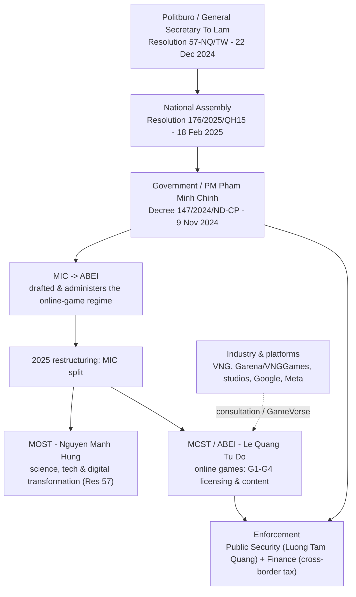

# Vietnam's Game Industry: A Seven-Part Research Synthesis (Forecast, Impact, Rationale, Actors, Motives, Reform, Regulator)

## Abstract

This paper ties together seven linked studies of Vietnam's video-game industry into a single
narrative and a trackable scorecard. The **forecast** paper projected an export factory that keeps
the world's top mobile-download crown while earning thin revenue per user, under a tightening
licensing regime. The **impact** paper traced how that situation reaches the country through six
channels - jobs, skills, tax, youth/society, digital sovereignty and soft power - with a net
positive on employment and branding but only a modest fiscal and GDP contribution. The **rationale**
paper explained the government's motives (ideological control, child protection, fiscal capture,
digital sovereignty, gambling enforcement, industrial promotion and bureaucratic politics). The
**actors** paper mapped who decides: a chain from the Political Bureau (Resolution 57, General
Secretary To Lam) through the National Assembly (Resolution 176/2025) and the Government (Decree
147/2024, Prime Minister Pham Minh Chinh) to the lead ministry (MIC's ABEI, then MOST and MCST after
the 2025 split) and enforcement agencies, with industry and platforms influencing only at the
margins. The **motive map** attributed reasons to each entity; the **reform** paper asked what it would take to change and how likely; and the **regulator** paper profiled ABEI/MCST, the agency at the operational centre. Read together, the series describes one trajectory: an **export-factory boom running into a
revenue, regulation and execution ceiling** - and a state practising **controlled liberalisation**.
The synthesis is interpretive and depends on the seven underlying papers; it is not new primary
research.

## 1. Introduction

Seven linked studies of Vietnam's video-game industry were published on 22 November 2026: a forecast, an impact assessment, a policy rationale, an actor map, a motive map, a reform-feasibility study and a regulator profile. This paper ties them into a single causal arc and restates their combined output as a trackable scorecard.

## 2. Evidence and method

```chart-stats
title: The series in numbers
| 7 | Underlying studies |
| 200 | Findings combined |
| 25 | Forecast and reform claims |
| 5 | Impact channels tracked |
caption: Figure 1. Seven papers, 200 findings and a 25-item scorecard consolidated into one trajectory [1, 2].
```

This is a **series synthesis**, not a new dataset. It consolidates seven finalized papers published
on 2026-11-22 under the `vietnam` shelf (plus the machine-readable scorecard):

- `vietnam-game-industry-forecast_2026-11-22` (33 findings) - baseline, predictions to 2031, scenarios.
- `vietnam-game-industry-impact_2026-11-22` (30 findings) - how the situation affects Vietnam.
- `vietnam-game-policy-rationale_2026-11-22` (25 findings) - why the government regulates this way.
- `vietnam-game-policy-actors_2026-11-22` (27 findings) - who makes the decisions.
- `vietnam-game-motive-map_2026-11-22` (27 findings) - which reasons drive which entity.
- `vietnam-game-policy-reform_2026-11-22` (31 findings) - what it would take to change, and how likely.
- `abei-and-mcst-game-regulation_2026-11-22` (27 findings) - inside the ABEI/MCST regulator.

Method: (1) extract each paper's key facts and claims; (2) align them into one causal arc
(baseline -> forecast -> impact -> rationale -> actors -> motives -> reform -> regulator); (3)
reconcile numbers across sources and flag disagreements; (4) convert the forecast, reform and impact
findings into a scorecard with resolve-by dates; (5) state seven cross-cutting findings with
confidence and sources. Facts are attributed to the external sources used in the underlying papers;
synthesis judgements are labelled analyst-based. No interviews or new data were collected.

## 3. Series map

| Paper ID | Title | Findings | Focus | Role in the arc |
|---|---|---:|---|---|
| `vietnam-game-industry-forecast_2026-11-22` | Vietnam's Video Game Industry: Forecasts to 2031 | 33 | predictions | Where the sector is heading |
| `vietnam-game-industry-impact_2026-11-22` | How Vietnam's Game-Industry Situation Affects the Country | 30 | national effects | What it does to Vietnam |
| `vietnam-game-policy-rationale_2026-11-22` | The Politics of Play: Why Vietnam Regulates Its Game Industry | 25 | motives | Why the state acts |
| `vietnam-game-policy-actors_2026-11-22` | Who Decides? The Institutions and People Behind Game Policy | 27 | actors | Who decides |
| `vietnam-game-motive-map_2026-11-22` | The Motive Map: Why Each Entity Enforces the Rules | 27 | entity motives | Who wants what |
| `vietnam-game-policy-reform_2026-11-22` | What It Would Take for Vietnam's Game Policy to Change | 31 | reform feasibility | What would change, how likely |
| `abei-and-mcst-game-regulation_2026-11-22` | Inside Vietnam's Game Regulator: ABEI, MCST and the Licensing State | 27 | regulator profile | The operational centre |

All seven live in `papers/vietnam/` and are listed in `papers/INDEX.md`. Combined they hold
200 findings; this synthesis adds seven cross-cutting findings.
## 4. The arc in brief

1. **Where it is heading (forecast).** Vietnam stays the world's #1 mobile-game exporter by
   downloads (9.6bn in 2024), but per-user revenue stays thin (~$0.06 ARPDAU ex-ads). Domestic
   mobile likely misses the $1bn-by-2030 target on its own; hyper-casual exporters stay largely
   outside the licence regime; VNG stays the anchor; Sky Mavis pivots to Ronin infrastructure.
2. **What it does to Vietnam (impact).** Games sit inside a ~$39bn digital economy (+17%) with
   ~$6bn online entertainment. Jobs, skills and nation-branding gain; tax and GDP gain modestly
   because value is captured offshore and ARPU is low; regulation protects minors but adds friction.
3. **Why the state acts (rationale).** Seven motives: obsolete Decree 72, ideological control,
   child protection, fiscal capture, industrial promotion, security/gambling, and bureaucratic
   politics - synthesised as "controlled liberalisation".
4. **Who decides (actors).** A chain: Politburo (Resolution 57) -> National Assembly (Resolution
   176/2025) -> Government (Decree 147/2024) -> lead ministry (MIC/ABEI, then MOST + MCST/ABEI) ->
   enforcement (Public Security, Finance). Industry and platforms influence at the margins.
5. **Who wants what (motive map).** Each entity's reasons: security/control (Party, Public Security),
   welfare (Assembly, MCST), fiscal (Government, Finance), industrial (Government, MOST, MCST), and
   institutional interest (MIC/ABEI, provinces).
6. **What it would take (reform).** "More carrots, same fences": promotion-side incentives are likely
   (55-75%), while content/data liberalisation (~30%), ending the local-entity rule (~15%) and a
   genuine value-capture upgrade (~35%) are unlikely before 2030-2031.
7. **The regulator (ABEI/MCST).** ABEI is both promoter (GameVerse, incentives) and enforcer (G1-G4
   licensing, 36% revocation, app-store removals); its capacity and predictability are the binding
   constraint.

## 5. Decision-flow diagram



## 6. Who's who - quick reference

| Layer | Actor | Role in game policy |
|---|---|---|
| Party | **To Lam** (General Secretary) | Politburo issued Resolution 57; drove the 2025 streamlining reform |
| Legislature | **National Assembly** | Resolution 176/2025 authorised the ministry restructuring |
| Government | **Pham Minh Chinh** (PM) | Heads the Government that issued Decree 147; chairs digital transformation |
| Lead ministry (pre-2025) | **MIC -> ABEI** | Drafted and administered Decree 147 and G1-G4 licensing |
| Tech ministry (post-2025) | **MOST - Nguyen Manh Hung** | "Core force" to implement Resolution 57; holds the digital mandate |
| Culture ministry (post-2025) | **MCST / ABEI - Le Quang Tu Do** | Now owns online games; operational face of game policy; GameVerse head |
| Enforcement | **Public Security; Finance** | Cyber/data enforcement; cross-border platform tax |
| Industry | **VNG, Garena/VNGGames, Funtap, ~210 studios** | Licensed publishers and exporter base; consultative influence |
| Platforms | **Google, Meta, ByteDance, Roblox, Riot** | Distribution and ad revenue; stakeholders, not rule-makers |

## 7. Prediction & impact scorecard

Track these against the forecast paper's predictions and the impact paper's channels. "Resolve by"
is the horizon; "Watch metric" is the falsifier.

| Claim | Horizon | Conf. | Resolve by | Watch metric |
|---|---|---:|---|---|
| Vietnam keeps #1 mobile-export crown | 2031 | 0.75 | 2031 | Google/Sensor Tower export ranking |
| Downloads grow, per-user revenue stays low | 2028 | 0.70 | 2028 | ARPDAU ex-ads vs ~$0.70 benchmark |
| Total market nears $1bn; domestic mobile misses it | 2030 | 0.60 | 2030 | Domestic mobile revenue vs $1bn |
| Decree 147 consolidates publishing around licensed locals | 2028 | 0.75 | 2028 | Share of top-grossing via licensed locals |
| Hyper-casual exporters stay outside the licence regime | 2028 | 0.70 | 2028 | Licensing applied to export studios? |
| Licensing friction and revocations persist | 2027 | 0.65 | 2027 | G1 revocation rate |
| VNG anchor; big overseas IPO unlikely before 2028 | 2028 | 0.55 | 2028 | Any completed major listing |
| Sky Mavis pivots to infrastructure; no Web3 mega-hit | 2028 | 0.60 | 2028 | New Vietnamese Web3 game at scale |
| M&A/consolidation among mid-size studios rises | 2028 | 0.60 | 2028 | Studio count / M&A volume |
| Vietnam grows as a co-development hub | 2029 | 0.65 | 2029 | Outsourcing revenue/headcount |
| AI squeezes hyper-casual margins | 2028 | 0.60 | 2028 | Studio margins after AI adoption |
| Senior talent remains the binding constraint | 2028 | 0.65 | 2028 | Senior wage/shortage indicators |
| Esports stays publisher-dependent | 2028 | 0.60 | 2028 | Publisher-run vs independent leagues |
| Mobile stays >85% of players | 2031 | 0.70 | 2031 | Platform mix of players |
| Games increasingly framed as cultural export | 2030 | 0.65 | 2030 | Policy/incentive language |

**Impact channels to watch:** games' share of digital-economy GMV; cross-border/platform tax
receipts; senior-talent retention; studio incorporation location; domestic-vs-export revenue split.

### Reform predictions (from the reform paper)

| Claim | Prob. | Horizon | Resolve by | Watch metric |
|---|---:|---|---|---|
| Promotion-side incentives keep expanding | 75% | 2028 | 2028-12-31 | Digital Technology Law / Decree 96 uptake |
| Games stay a priority cultural industry with tax breaks | 70% | 2028 | 2028-12-31 | Priority-list status |
| Continued consolidation around licensed locals | 75% | 2028 | 2028-12-31 | Top-grossing share via locals |
| Moderate licensing simplification | 55% | 2028 | 2028-12-31 | G1 time / revocation rate |
| Talent retention improves via incentives | 45% | 2029 | 2029-12-31 | Senior emigration |
| Deeper content/data liberalisation | 30% | 2030 | 2030-12-31 | Data / real-name rules |
| End of the local-entity publishing requirement | 15% | 2031 | 2031-12-31 | Local-entity rule |
| Independent esports at scale | 25% | 2030 | 2030-12-31 | Independent leagues |
| A genuine value-capture upgrade | 35% | 2031 | 2031-12-31 | Share of revenue from original IP |
| Implementation capacity improves enough to matter | 45% | 2029 | 2029-12-31 | Procedures / predictability |

## 8. Cross-cutting findings

**F1 - An export boom against a ceiling.** Vietnam is the world's top mobile-game exporter by
downloads (9.6bn in 2024) yet earns ~$0.06 ARPDAU ex-ads; the same pattern - high volume, low
value capture - recurs across the forecast, impact and rationale papers. The ceiling is structural,
not cyclical. [1, 2]

**F2 - Controlled liberalisation.** The state simultaneously promotes games (priority cultural
industry, $1bn target, tax incentives) and controls them (licensing, localisation, age gates). The
two halves are one policy, not competing factions. [2, 3]

**F3 - Volume is not value.** Downloads/assembly are large; revenue/design capture is small. The
upgrade path is original IP, higher-value games and senior talent - the same "assembly vs design"
problem as manufacturing. [1]

**F4 - The institutional reset.** Decree 147 (9 Nov 2024) plus the 2025 split of MIC into MOST and
MCST moved the game file from the tech ministry to the culture ministry; the fast-track reorg
affected over 1,300 administrative procedures, raising near-term licensing risk. [4, 5]

**F5 - A chain, not a person.** Direction comes from the Politburo (Resolution 57), the frame from
the National Assembly (Resolution 176/2025), the rule from the Government (Decree 147), execution
from ABEI (now under MCST), and enforcement from Public Security and Finance. Industry and platforms
influence at the margins. [3, 6]

**F6 - Reform is asymmetric.** The 14th Congress (Jan 2026) supplied a top-level mandate and a 2026
Digital Technology Law plus Decree 96 incentives, while the US 20% tariff pushes upgrading - so
promotion-side change is likely (55-75%). But institutional capacity and the security/content
coalition block deep liberalisation, so content/data liberalisation (~30%) and ending the
local-entity rule (~15%) are unlikely before 2030-2031. [11, 12, 13, 14]

**F7 - The regulator is the hinge.** ABEI (now under MCST) is both promoter (GameVerse, incentives)
and enforcer (G1-G4 licensing, 36% revocation, app-store removals), and its remit is expanding to
advertising and influencers. Its capacity and predictability - not its legal powers - are the
binding constraint on a healthy industry. [3, 15]

## 9. Interpretation and confidence

**Not applicable.** This synthesis analyses an industry and policy
system, not an individual or organisation, so the toolkit's 0-100 adverse-signal score has no
subject. A score of 0/100 (NONE) records that no such assessment was in scope.

## 10. Limitations

- This is a **synthesis** of seven papers; it inherits their limitations and adds no primary data.
- Market figures disagree by method ($817M total-2024; ~$825M mobile-2025; a ~$315M tracker; a
  $1.66bn industry headline), so absolute levels are indicative, not precise.
- Predictions and reform probabilities are subjective and time-stamped; re-grade them at each
  "resolve by" date.
- Named roles/titles can change after the 2024-25 restructuring; verify current office-holders.
- Some facts rest on trade press and encyclopaedic records that can be revised.
- Absence of a finding is not proof of absence; public data changes.

## References

[1] https://digitalinasia.com/vietnam-mobile-gaming-market/
[2] https://digitalinasia.com/decree-147-vietnam-gaming/
[3] https://vietnamnet.vn/en/vietnam-s-gaming-industry-levels-up-with-global-ambitions-2514616.html
[4] https://vietnamlawmagazine.vn/new-decree-on-management-provision-and-use-of-internet-services-and-online-information-73525.html
[5] https://vietnam-business-law.info/blog/2025/5/26/vietnam-enacts-major-government-restructuring-in-early-2025
[6] https://english.luatvietnam.vn/resolutionno57-nq-twdateddecember222024ofthepoliticalbureauonbreakthroughsinthedevelopmentofsciencetechnologyinnovationandna-381835-doc1.html
[7] https://en.vietnamplus.vn/vietnam-gameverse-2026-aims-to-elevate-local-gaming-industry-globally-post342452.vnp
[8] https://vietnamnet.vn/en/vietnam-s-digital-economy-hits-usd-39-billion-ai-and-e-commerce-drive-growth-2466540.html
[9] https://vietcetera.com/en/google-pays-87-million-in-taxes-to-vietnam-biggest-among-cross-border-platforms
[10] https://en.wikipedia.org/wiki/Axie_Infinity
[11] https://en.wikipedia.org/wiki/14th_National_Congress_of_the_Communist_Party_of_Vietnam
[12] https://en.baochinhphu.vn/full-resolution-of-14th-national-party-congress-111260214171856653.htm
[13] https://www.bakermckenzie.com/-/media/files/insight/publications/2026/02/vietnamdigital-technology-lawlegal-foundations-and-strategic-incentives-to.pdf
[14] https://ustr.gov/about/policy-offices/press-office/fact-sheets/2025/october/fact-sheet-united-states-and-viet-nam-reach-framework-agreement-reciprocal-fair-and-balanced-trade
[15] https://vietnamnet.vn/en/vn-steps-up-oversight-of-influencers-online-advertising-and-digital-conduct-2518400.html
